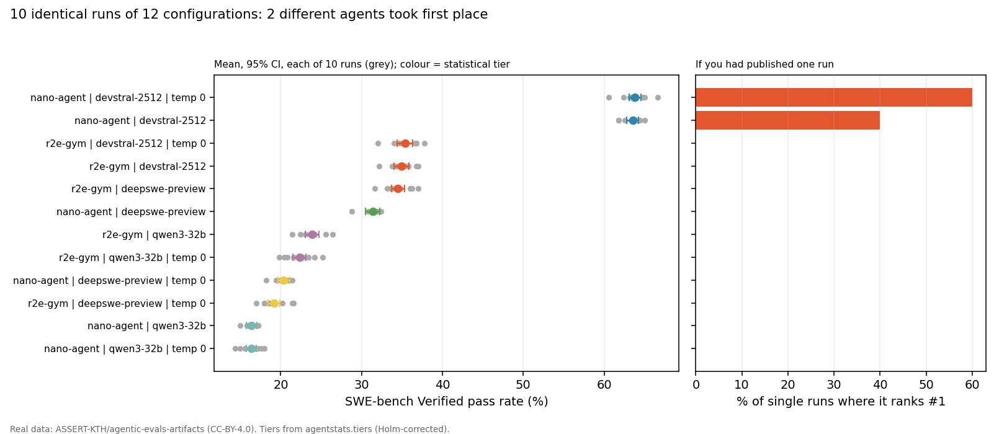

# agentstats

**Run-to-run variance, significance tests and minimum-runs planning for AI agent benchmarks**
(SWE-bench, WebArena, OSWorld, and anything else that scores tasks as success or failure).

Agent leaderboards rank systems by gaps of 1–3 pp, usually from one run. `agentstats` tells you
whether a gap is real, how many runs you need before it can be, and whether your noise is the kind
that breaks standard tests.

```bash
pip install "agentstats @ git+https://github.com/RishabhPande/agentstats.git"             # core
pip install "agentstats[swebench] @ git+https://github.com/RishabhPande/agentstats.git"   # + SWE-bench leaderboard loader
```

`agentstats` is not on PyPI: the `agentstats` name there belongs to an unrelated package. Install from this repo.

## What it shows



Real data: 12 configurations x 10 runs on SWE-bench Verified, from
[ASSERT-KTH](https://huggingface.co/datasets/ASSERT-KTH/agentic-evals-artifacts) (CC-BY-4.0). The two leaders sit in
the same statistical tier, and which one tops a published leaderboard depends on which run you happened to pick.
Regenerate with `python examples/leaderboard_uncertainty.py` (needs `matplotlib`, about 25 s).

## Input: a run table

One row per (agent, task, run). Extra columns are treated as nuisance factors.

| agent | task | run | success | api_date | env_version | latency |
|---|---|---|---|---|---|---|
| openhands | django-11099 | 0 | 1 | 2026-07-01 | v1.3 | p50 |
| openhands | django-11099 | 1 | 0 | 2026-08-01 | v1.3 | p95 |

`success` can be 0/1 or a score in [0, 1]. Each `run` should be one complete pass over the benchmark.

## Python

```python
import agentstats as ast
df = ast.load("runs.csv")

ast.agent_scores(df)                     # score, SE from run noise, CI
ast.design_effect(df)                    # is noise correlated within runs? (DEFF >> 1 -> use level="run")
ast.compare(df, "A", "B")                # studentized stratified run-permutation test
ast.compare(df, "A", "B", level="run")   # run-level Welch test, robust to API drift / env breakage
ast.pairwise(df, adjacent_only=True)     # Holm-corrected adjacent leaderboard gaps
ast.tiers(df)                            # statistically tied groups (report these, not ranks)
ast.flip_statistics(df)                  # Kendall tau / P(#1 changes) between single-run leaderboards
ast.decompose(df)                        # variance components: seed vs api_date vs env_version ...
ast.plan(pilot_df, delta=0.02)           # minimum runs per agent to detect a 2 pp gap
print(ast.report(df))                    # all of the above, as markdown
```

## CLI

```bash
agentstats report runs.csv
agentstats compare runs.csv agentA agentB --level run --strata api_date
agentstats plan pilot.csv --delta 0.02
agentstats plan-generic --tasks 500 --delta 0.02 --flakiness 0.1
agentstats audit leaderboard.json --sd 1.5      # audit published numbers without re-running

# audit the live SWE-bench leaderboard (pip install agentstats[swebench])
git clone --depth 1 https://github.com/SWE-bench/experiments
agentstats swebench-audit experiments --pass1 --top 20
```

## The minimum-runs protocol

1. **Pilot, then plan.** Run each agent at least 3 times; `agentstats plan` gives *k* for the smallest gap you want to claim. With no pilot, use *k* = 5.
2. **Spread runs over conditions you don't control**: at least 2 API dates or environment builds. Interleave competing agents so you can block on those conditions (`strata=`).
3. **Diagnose correlation.** If median DEFF > 1.5, use `level="run"`.
4. **Test pairs and correct for multiplicity** (Holm; built in).
5. **Report tiers, not ranks.**
6. **Log conditions**: snapshot ids, provider fingerprints, image digests, latency, and per-task outcomes.
7. **State the estimand**: this benchmark (`inference="benchmark"`) or the task population (`"population"`).

## Which test?

| Situation | Use |
|---|---|
| 1 run per agent | `inference="population"` (paired sign-flip over tasks); collect more runs |
| ≥2 runs, DEFF ≈ 1 | default: studentized stratified run-permutation (`level="task"`) |
| ≥3 runs, DEFF > 1.5 | `level="run"` (Welch on complete-run scores) |
| agents run on the same API dates / images | add `strata=[...]` to block on them |

## Validation

`pytest` checks type-I error under sharp and weak nulls and under run-correlated noise, the power of the planner, variance-component recovery, Monte Carlo resolution under Holm correction, and the CLI.

## Reproducing the paper

See [`reproduce/`](reproduce/README.md).

## Citation

> R. Pande. *Within the Noise: The Reproducibility Crisis in Agent Benchmarks.* 2026.

MIT license.
